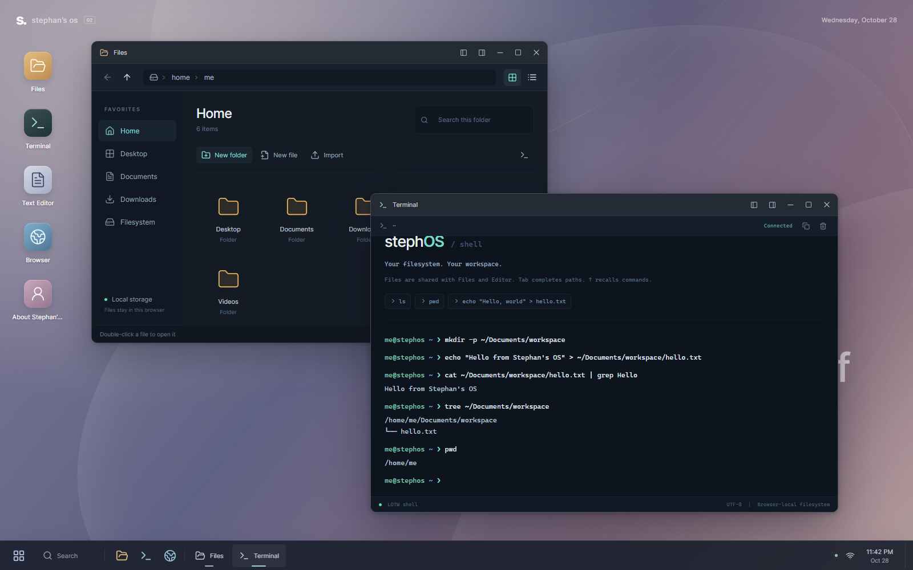

# Stephan’s OS

A personal desktop in your browser, built with React and Next.js. Terminal, Files, Text Editor, Calendar, and Search use **one persistent filesystem**, powered by the actual [Linux on the Web](https://github.com/linuxontheweb/linuxontheweb.github.io) filesystem and shell. Window geometry and state transitions adapt code from [Dustin Brett’s daedalOS](https://github.com/DustinBrett/daedalOS).

This is a browser desktop with a programmable JavaScript shell. It does not run a Linux kernel or native executables.



## Run locally

Use Node.js 22 and npm.

```sh
git clone https://github.com/CryptoStephan/Stephans-OS.git
cd Stephans-OS
npm ci
npm run dev
```

Open the address printed by Next.js, normally [http://127.0.0.1:3000](http://127.0.0.1:3000). Use the same hostname and port when returning to your files: browser storage belongs to that exact origin.

For a production build:

```sh
npm run build
npm start
```

The build creates `out/`. The included server serves that static directory at `127.0.0.1:3000`; the `PORT` environment variable changes its port. No application server, account, or API key is needed.

## What works

- **Desktop:** searchable launcher, taskbar, multiple application windows, focus ordering, eight resize handles, minimize/restore, maximize, left/right snapping, edge snap previews, and restored window layouts. Desktop files appear from the shared filesystem, icon ordering persists, and host file drops import without overwriting existing names. Appearance has three saved themes.
- **Terminal:** LOTW’s tokenizer, parser, and execution engine; quoted paths, pipes, redirects and append, variables, command substitution, control flow, and functions. Each terminal has its own working directory and environment. The interface adds history, path completion, copy output, and cancellation.
- **Files:** shared live directory listings, breadcrumbs, grid/list views, filename filtering, create/rename/copy/move/delete, symbolic-link navigation, and binary-safe import/download. New imports avoid existing filenames.
- **Text Editor:** UTF-8 text, Save/Save As, keyboard saving, unsaved-change protection, and external-change refresh when the buffer is clean. Binary, invalid UTF-8, unreadable, and larger-than-2-MiB files are not opened as editable text.
- **Calendar:** dated notes stored in the shared filesystem.
- **Search:** recursive filename search within Home.
- **Utilities:** calculator, memory game with a saved best score, city weather from Open-Meteo, and a sandboxed web viewer with back/forward navigation.
- **Settings:** storage usage and quota, a browser persistence request, appearance, and an explicit import from the previous desktop.

A quick cross-application check:

```sh
mkdir -p ~/Documents/demo
echo "Hello from the shell" > ~/Documents/demo/hello.txt
cat ~/Documents/demo/hello.txt | grep Hello
ln -s ~/Documents/demo/hello.txt ~/Desktop/hello.txt
```

Open `Documents/demo/hello.txt` in Files, edit and save it, then read it again with `cat`. Reload the page and the saved file remains.

Use `help` in Terminal for the available command list.

## Storage and existing files

Files live in this browser profile and website origin. IndexedDB stores LOTW’s directory and link metadata; OPFS stores file contents. Desktop preferences and terminal history use localStorage. There is no cloud sync.

The new runtime has its own storage namespace. It does **not** automatically overwrite or erase the previous desktop’s direct OPFS files.

To recover older files on the **same website address and browser profile**:

1. Open **Settings → Bring your old files along**.
2. Select **Import old desktop files**.
3. Open the new `/home/me/Imported from old desktop` folder.

The importer copies binary files without text conversion, reconstructs the old `filesystemData` localStorage hierarchy when available, and preserves raw metadata snapshots. Originals remain unchanged. A repeated import creates a separate numbered folder; errors and partial results are shown.

Only **one desktop tab per origin** may own the filesystem at a time. Close the first tab and reload the second to switch. This prevents competing copies of LOTW’s cached metadata.

Browser quotas and storage eviction still apply. Requesting persistent storage is subject to the browser’s decision, and clearing site data removes files. Download important files before clearing storage or changing domains.

## Keyboard shortcuts

| Action                  | Shortcut                              |
| ----------------------- | ------------------------------------- |
| Open Terminal           | Ctrl + Alt + T                        |
| Open Files              | Ctrl + Alt + E                        |
| Application launcher    | Ctrl + Space                          |
| Save document           | Ctrl/Cmd + S                          |
| Save As                 | Ctrl/Cmd + Shift + S                  |
| Terminal history        | Up / Down                             |
| Complete terminal path  | Tab                                   |
| Cancel terminal command | Ctrl + C                              |
| Clear terminal display  | Ctrl + L                              |
| Close active window     | Alt + F4, where the browser allows it |

## Verify changes

```sh
npm run typecheck
npm test
npm run test:e2e
npm run build
```

The browser suite uses an installed Google Chrome by default and starts a development server on port 3000 if needed. To use Playwright’s downloaded Chromium instead:

```powershell
npx playwright install chromium
$env:PLAYWRIGHT_CHANNEL = "chromium"
npm run test:e2e
```

On a POSIX shell, use `PLAYWRIGHT_CHANNEL=chromium npm run test:e2e`. Set `PLAYWRIGHT_SERVER_COMMAND` to `npm start` to test the production build after building it. Failures retain traces and screenshots; run `npx playwright show-report` to inspect the HTML report.

The suite contains 12 unit tests and 18 browser tests covering window state and session validation, shell/Files/Editor interoperability and reload persistence, file and directory links, binary round trips, filename collisions, legacy import preservation, cancellation, special filenames, editor protection, utility behavior, and narrow-screen controls. Weather tests use deterministic responses rather than relying on live service availability. GitHub Actions runs type checking, unit tests, the static build, and the browser suite against that production build.

## Deploy

This is a static export. On Netlify, `netlify.toml` configures:

- Build: `npm run build`
- Publish directory: `out`
- Node.js: `22`

Other HTTPS static hosts can serve the entire `out/` directory. Keep `/runtime/lotw/` accessible at the site root. OPFS and Web Locks require a supported browser and secure context; localhost is suitable for development. The runtime is not configured for hosting beneath a URL subdirectory.

Deploying to a new domain does not migrate data from an old origin. Import or download data while visiting the original origin first.

## Current boundaries

The terminal does not execute native Linux binaries, package managers, or host-system commands. Full-screen LOTW applications such as `vim` and `less`, background shell jobs, and simultaneous desktop tabs are not connected. Long commands have a deadline and can be cancelled.

The web viewer cannot override another website’s embedding restrictions; it offers an external-tab link. Weather needs network access. Unsaved editor contents and shell environment variables are not restored after a page reload. File operations spanning IndexedDB and OPFS are not one atomic transaction, and deletion is permanent after confirmation.

The application has four runtime dependencies: Next.js, React, React DOM, and Lucide React. The previous duplicate filesystem/context implementations, backup components, unused UI scaffolding, and unreferenced dependencies have been replaced by the shared runtime and application layer. Original source remains available in Git history.

See [architecture and integration details](docs/ARCHITECTURE.md), [LOTW changes and provenance](public/runtime/lotw/PROVENANCE.md), and [third-party notices](THIRD_PARTY_NOTICES.md).

## Attribution and permissions

Stephan’s OS retains its [MIT license](LICENSE) for its own code. Adapted daedalOS code retains [Dustin Brett’s MIT notice](lib/desktop/LICENSE.daedalOS). The project owner confirmed permission to reuse and publicly distribute LOTW’s source; that permission is documented separately and does not imply that upstream LOTW is MIT licensed. See [THIRD_PARTY_NOTICES.md](THIRD_PARTY_NOTICES.md).
