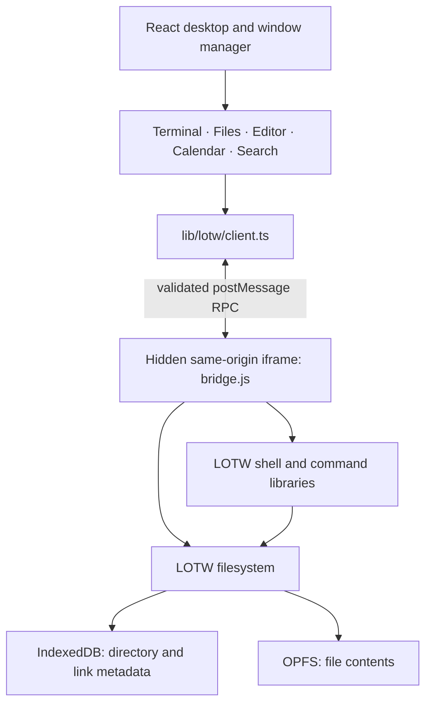

# Architecture

The application keeps one filesystem authority: a vendored Linux on the Web runtime. React owns the desktop interface. A small typed bridge joins them without importing LOTW’s global state or prototype additions into React’s JavaScript realm.



The iframe separates runtime globals and prototypes. It is **not a security boundary** against other code served on the same origin. The bridge accepts messages only from its parent and checks the origin and channel; the client checks the origin and exact iframe source. The external web viewer uses a separate sandboxed iframe.

## Source map

| Path                                            | Responsibility                                                              |
| ----------------------------------------------- | --------------------------------------------------------------------------- |
| `app/page.tsx`, `app/layout.tsx`                | Application entry and global styling                                        |
| `components/os/Desktop.tsx`                     | Desktop, launcher, taskbar, pointer interaction, window frames              |
| `components/os/DesktopFiles.tsx`                | Shared desktop files, saved ordering, keyboard interaction, host file drops |
| `lib/desktop/geometry.ts`, `reducer.ts`         | Geometry and immutable state, adapted from daedalOS                         |
| `lib/desktop/session.ts`, `useWindowManager.ts` | Validated session persistence and React integration                         |
| `components/os/apps/Files.tsx`                  | Filesystem navigation and file operations                                   |
| `components/os/apps/Editor.tsx`                 | Guarded UTF-8 editing and save lifecycle                                    |
| `components/os/apps/Terminal.tsx`               | Interactive command UI and per-window session                               |
| `components/os/apps/legacy-import.ts`           | Non-destructive old-storage migration                                       |
| `components/os/UtilityApps.tsx`                 | Settings, calendar, search, calculator, game, weather, browser, about       |
| `lib/lotw/client.ts`                            | Typed asynchronous client and change subscriptions                          |
| `public/runtime/lotw/index.html`                | Isolated runtime boot order                                                 |
| `public/runtime/lotw/bridge.js`                 | Filesystem RPC, terminal adapter, command additions, queue, ownership lock  |
| `public/runtime/lotw/sys/fs.js`                 | Actual LOTW filesystem implementation                                       |
| `public/runtime/lotw/mods/lang/shell.js`        | Actual LOTW tokenizer, parser, and shell execution                          |
| `public/runtime/lotw/coms/fs.js`                | Original LOTW filesystem command library                                    |
| `scripts/serve.mjs`, `netlify.toml`             | Static production serving and deployment                                    |

Upstream revisions and modification details are recorded beside the vendored sources. There is no second React filesystem, BrowserFS instance, or independent editor storage.

## Boot and persistence

`lotw.ready()` creates exactly one hidden iframe per application instance. The iframe loads configuration, utility code, the filesystem, the shell, and the adapter. It acquires a lifetime Web Lock before initializing persistent storage. If another desktop tab already owns the lock, startup fails with an actionable message rather than running a competing metadata cache.

The runtime creates the home directory `/home/me`, its Desktop and standard folders, and an initial welcome document only when missing. Namespace details:

| Store                          | Name / purpose                                                            |
| ------------------------------ | ------------------------------------------------------------------------- |
| IndexedDB                      | `StephansOS-LOTW-v1`: filesystem metadata                                 |
| OPFS directory                 | `stephans-os-blobs-v1`: file contents                                     |
| localStorage counter           | `stephans-os-next-blob-id-v1`: next candidate blob ID                     |
| localStorage desktop session   | `stephans-os:desktop:v2`: windows, focus, geometry, document/folder paths |
| Other localStorage preferences | Wallpaper, terminal history, memory-game best score                       |

Metadata points to OPFS blobs instead of mapping every browser directory directly to a virtual directory. This supports symbolic links and multiple hard links to the same stored contents. Removing one hard link must not reclaim the blob while another reference remains.

The allocation counter is only a candidate. Allocation also checks metadata and OPFS so clearing that localStorage key cannot overwrite an existing blob. Browser quota estimates cover the entire origin, not only this application’s files. Browser persistence permission and filesystem availability are separate states.

## Scheduling and cancellation

Mutating RPC calls and complete shell executions are serialized. This keeps directory updates and sequential shell writes ordered. `list`, `stat`, `readText`, `readFile`, storage queries, persistence requests, and cancellation bypass the mutation queue; opening Files does not wait for a sleeping command to finish.

Reads are not transactional snapshots of a multi-step shell command. They may see intermediate state. A completed mutation or execution emits a change notification, and subscribers refresh from the shared filesystem.

Each terminal uses a unique session ID. Its shell keeps an independent current directory and environment, while all terminals share files. Cancellation can interrupt active commands and mark queued executions so a closed terminal does not execute later. The runtime enforces a 110-second command deadline; the client’s 120-second response timeout also sends cancellation. Ordinary RPC requests have a 30-second response timeout.

Long synchronous shell sequences periodically yield to the browser so cancellation and the interface can run. Background jobs are rejected because they would otherwise escape the ordered execution contract.

## Client API

Import `lotw`, `HOME`, and the exported types from `lib/lotw/client.ts`.

```ts
await lotw.ready();
await lotw.mkdir(`${HOME}/Documents/example`);
await lotw.writeFile(`${HOME}/Documents/example/note.txt`, "Hello\n", {
  exclusive: true,
});
const text = await lotw.readText(`${HOME}/Documents/example/note.txt`);

const result = await lotw.execute("cat Documents/example/note.txt", {
  sessionId: "my-terminal",
  cwd: HOME,
  onOutput: ({ text, kind }) => console.log(kind, text),
});
```

| Method                                         | Contract                                                                                      |
| ---------------------------------------------- | --------------------------------------------------------------------------------------------- |
| `ready()`                                      | Boot once; resolve runtime metadata or reject startup failure                                 |
| `list(path)`                                   | Sorted `FsEntry[]` for a directory                                                            |
| `stat(path)`                                   | Entry metadata; preserves a symbolic link as a link                                           |
| `readText(path)`, `readFile(path)`             | UTF-8 decoded text or original `Uint8Array` bytes; reads follow symbolic links                |
| `writeFile(path, data, {exclusive?})`          | Write string/bytes; `exclusive: true` rejects existing destinations inside the mutation queue |
| `mkdir(path)`                                  | Create one directory; existing names are errors                                               |
| `move(source, target)`, `copy(source, target)` | Move/copy an entry; existing destination collisions fail                                      |
| `remove(path, {recursive?})`                   | Remove the entry itself; recursive removal is explicit                                        |
| `link(source, target, {symbolic?})`            | Hard link by default, or symbolic link                                                        |
| `execute(command, options)`                    | Stream output; return exit code, current directory, final output, and clear state             |
| `cancel(sessionId)`                            | Cancel active or queued execution for that terminal                                           |
| `subscribe(callback)`                          | Observe completed filesystem changes; returns unsubscribe function                            |
| `storage()`, `persist()`                       | Browser storage estimates and persistence permission                                          |

`FsEntry` contains `name`, `path`, `type`, `size`, and optional `linkTarget`. `type` is `file`, `directory`, or `symlink`. Shell output has `text` and `kind` (`stdout`, `error`, `info`, `warning`). The client throws errors; applications show them instead of silently treating failures as empty directories or successful writes.

`readText()` is a general decoding convenience, not a binary-safety check. Editor uses `readFile()` with fatal UTF-8 decoding, a NUL check, and a 2-MiB size limit. Import and download retain bytes unchanged.

## Application state

The window reducer owns focus ordering, minimize/maximize state, normal restoration rectangles, and left/right snap modes. Geometry is bounded by the available viewport. Session restoration validates known app IDs, finite dimensions, duplicate IDs, payload size, and window count before clamping the saved layout to the current viewport.

Minimizing hides a mounted window so its editor buffer or terminal session stays alive. Saving a document under a new path, navigating Files, and changing terminal directories update the persisted window path. Unsaved buffers and shell environment variables are deliberately not written into the desktop session. Desktop icons reflect files in `/home/me/Desktop`, preserve their ordering, and accept host file drops using exclusive creation.

Editor handles a cancelable `stephos:beforeclose` event and the browser’s `beforeunload` event. Clean documents refresh after external filesystem changes. Dirty buffers remain in memory and show an external-change message. Invalid or unreadable backing files block editing and saving, including after external changes.

Calendar persists its notes in `/home/me/.calendar.json`. Search traverses names beneath Home. Weather sends the requested city and coordinates to Open-Meteo; it does not send filesystem contents. The web viewer makes requests to user-selected websites and respects iframe restrictions.

## Legacy migration

Migration runs only when the user selects the Settings import action. It snapshots direct OPFS root entries, excludes known LOTW runtime blob directories, and copies source file bytes into a newly named import folder. The optional localStorage migration reads the old `filesystemData` and `desktopItems` keys, reconstructs valid parent-linked text files, and preserves original JSON snapshots even when reconstruction fails.

Each import has a unique destination and exclusive file creation. Source files and keys are never deleted. Cancellation stops between operations; completed copies remain available. Reports distinguish copied files, created folders, excluded internal stores, and errors. This does not bypass the browser’s origin boundary: the original hostname, port, and browser profile must be accessible.

## Focused upstream repairs

The vendored LOTW source includes targeted fixes for root-bounded path normalization, prototype-shaped filenames, symbolic-link traversal budgets, removing a link without deleting its target, recursive-removal errors, append completion and size reporting, space-containing paths, async command settlement, exit-status propagation, cancellation, and collision-safe blob allocation.

The adapter adds useful filesystem/text commands, recursive copies that preserve empty directories and links, rollback attempts after failed copies, and deletion that reclaims only unreferenced blobs. See the [complete provenance and change record](../public/runtime/lotw/PROVENANCE.md).

## Verification and limits

`npm test` covers the pure window reducer, geometry, and persisted-session validation. Playwright exercises the actual browser runtime and interactions among applications, including reload persistence, quoted filenames, pipelines, links, binary import/download, migration, cancellation, collision and counter-reset protection, editor binary guards, utility behavior, and mobile-width controls. Network-dependent weather responses are mocked for deterministic tests. `npm run typecheck` and `npm run build` check application compilation and static export. GitHub Actions runs the browser suite against `npm start` using `PLAYWRIGHT_SERVER_COMMAND`, so CI verifies the generated static site.

There is no Linux kernel, native process execution, full-screen terminal emulator, package manager, cloud synchronization, background job scheduler, or multi-tab filesystem coherence layer. OPFS and IndexedDB do not provide one atomic transaction spanning both stores. Copies use best-effort rollback, not a general journaled transaction system. Storage can still be removed by the browser or user. These boundaries are part of the current implementation rather than hidden behind simulated success.
